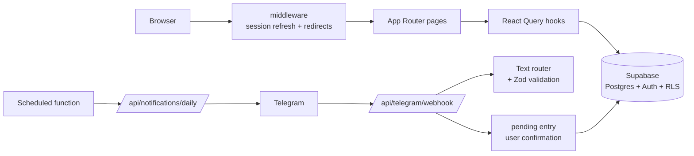

# crewve

**Keep your whole life in one dashboard: money, meals, workouts, habits, notes and calendar. Add entries on the web, or just type them in Telegram.**

Hi, this is the showcase repo for crewve. The app's source code lives in a private repo, so here I'm sharing what the product does, how I built it, and a few examples picked from the code.

<!-- TODO: screenshot — dashboard -->
<!-- TODO: screenshot — adding an entry from Telegram and the confirmation flow -->
<!-- TODO: screenshot — reports -->

## Who it's for and what problem it solves

I made this for anyone who tracks spending in one app, meals in another, workouts in notes and habits in their head (I was doing exactly that). Scattered tracking is tracking you can't keep up. crewve brings everything into one account and makes adding an entry as easy as possible: in Telegram, writing "50 lira yemek" (50 lira, food) or "öğle tavuk pilav yedim" (had chicken and rice for lunch) is enough.

## What it offers

- **Finance:** income and expenses, categories, and monthly and 30-day trend charts.
- **Meals, workouts and habits:** health and routine tracking, with streak tracking for habits.
- **Notes and calendar:** tagged notes, a tag filter and a calendar view.
- **Telegram integration:** add entries with free text. The message is routed to the right module, validated against a schema, and saved once you confirm. Linking your account uses a one-time code that expires.
- **Daily summary notification:** at the end of the day, a summary arrives in Telegram.
- **Dashboard and reports:** a summary of every module on one screen, with details on the reports page.
- **Achievements:** badges and a shareable achievement card.
- **Export:** download your data as JSON and convert it to CSV.
- **Privacy settings:** your data is yours, and you control it from settings.
- **Getting started and comfort:** an onboarding flow, Turkish and English interface, dark mode and a blog.

## Under the hood

- **Next.js 16 + React 19 + TypeScript**, App Router.
- **Supabase** (Postgres, Auth) with row-level security (RLS): every user can only reach their own data.
- **Validated data:** model output coming from Telegram never gets written to the database before it passes a Zod schema.
- **Quality gates:** Husky + lint-staged, ESLint, Prettier and conventional commits (commitlint).

## Stack

| Area | Choice |
| --- | --- |
| Framework | Next.js 16 (App Router), React 19, TypeScript |
| Data and auth | Supabase (Postgres, Auth, RLS), `@supabase/ssr` |
| Client state | TanStack React Query |
| UI | Tailwind CSS 4, shadcn/ui (Radix), framer-motion, Recharts |
| Validation | Zod |
| Natural language parsing | Groq API (JSON output) |
| Bot | Telegram Bot API (webhook) |
| Deployment | Netlify (scheduled function) |

## Code quality

The quality gates run locally at commit time:

- Husky `pre-commit`: ESLint `--fix` and Prettier on changed files through lint-staged
- Husky `commit-msg`: commitlint (conventional commits)
- A branch and PR flow for each feature (21 merged PRs so far)

<!-- TODO: add test evidence here once tests exist -->

## Example modules

- [`src/lib/env.ts`](src/lib/env.ts): validates environment variables with Zod. It keeps the variables exposed to the client and the ones read only on the server in separate schemas, and the app stops at startup if a value is missing or invalid.
- [`middleware.ts`](middleware.ts) and [`src/lib/supabase/middleware.ts`](src/lib/supabase/middleware.ts): refresh the Supabase session through cookies on every request. They redirect signed-out users from protected pages to login, and signed-in users from the login page to the dashboard.

Btw, these files aren't a standalone project. They expect the Next.js and `@supabase/ssr` dependencies.

## License

MIT. See [LICENSE](LICENSE) for details.
