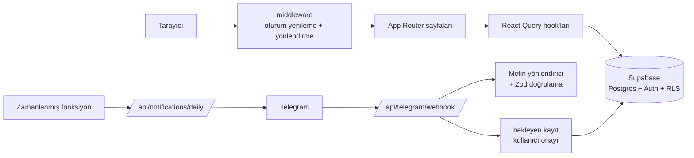

# crewve

**Hayatını tek panelde topla: para, öğün, antrenman, alışkanlık, not ve takvim. Kaydı web'den gir ya da Telegram'dan sadece yaz.**

Bu repo crewve'un vitrinidir. Uygulamanın kaynak kodu private repoda durur; burada ürünün ne yaptığı, nasıl kurulduğu ve koddan seçilmiş örnekler var.

<!-- TODO: ekran görüntüsü — dashboard -->
<!-- TODO: ekran görüntüsü — Telegram'dan kayıt ekleme ve onay akışı -->
<!-- TODO: ekran görüntüsü — raporlar -->

## Kimin için, hangi sorunu çözüyor

Harcamaları bir uygulamada, yemekleri başka bir uygulamada, antrenmanları notlarda, alışkanlıkları kafada tutan herkes için. Dağınık takip, sürdürülemeyen takiptir. crewve hepsini tek hesapta toplar ve kayıt girmeyi en kolay hale getirir: Telegram'a "50 lira yemek" ya da "öğle tavuk pilav yedim" yazmak yeterli.

## Neler sunuyor

- **Finans:** gelir ve gider, kategoriler, aylık ve 30 günlük trend grafikleri.
- **Öğünler, antrenmanlar ve alışkanlıklar:** sağlık ve rutin takibi; alışkanlıklarda seri (streak) takibi.
- **Notlar ve takvim:** etiketli notlar, etiket filtresi ve takvim görünümü.
- **Telegram entegrasyonu:** serbest metinle kayıt ekle. Mesaj ilgili modüle yönlendirilir, şemayla doğrulanır ve sen onaylayınca kaydedilir. Hesap bağlama tek kullanımlık, süreli bir kodla yapılır.
- **Günlük özet bildirimi:** gün sonunda Telegram'dan özet gelir.
- **Dashboard ve raporlar:** tüm modüllerin özeti tek ekranda, ayrıntılar rapor sayfasında.
- **Başarımlar:** rozetler ve paylaşılabilir başarım kartı.
- **Dışa aktarma:** verini JSON olarak indir, CSV'ye çevir.
- **Gizlilik ayarları:** verin senin; ayarlardan kontrol edersin.
- **Hazırlık ve konfor:** onboarding akışı, Türkçe ve İngilizce arayüz, karanlık mod, blog.

## Teknik güç

- **Next.js 16 + React 19 + TypeScript**, App Router.
- **Supabase** (Postgres, Auth) ve satır düzeyi güvenlik (RLS): her kullanıcı yalnız kendi verisine erişir.
- **Doğrulanmış veri:** Telegram'dan gelen model çıktısı Zod şemasından geçmeden veritabanına yazılmaz.
- **Kalite kapıları:** Husky + lint-staged, ESLint, Prettier ve conventional commits (commitlint).

## Teknoloji

| Alan | Seçim |
| --- | --- |
| Framework | Next.js 16 (App Router), React 19, TypeScript |
| Veri ve kimlik | Supabase (Postgres, Auth, RLS), `@supabase/ssr` |
| İstemci durumu | TanStack React Query |
| UI | Tailwind CSS 4, shadcn/ui (Radix), framer-motion, Recharts |
| Doğrulama | Zod |
| Doğal dil çözümleme | Groq API (JSON çıktı) |
| Bot | Telegram Bot API (webhook) |
| Dağıtım | Netlify (zamanlanmış fonksiyon) |

## Kod kalitesi

Kalite kapıları commit anında yerelde çalışır:

- Husky `pre-commit`: lint-staged ile değişen dosyalara ESLint `--fix` ve Prettier
- Husky `commit-msg`: commitlint (conventional commits)
- Özellik başına dal ve PR akışı (geçmişte 21 birleştirilmiş PR)

<!-- TODO: test eklenirse kanıtı buraya -->

## Örnek modüller

- [`src/lib/env.ts`](src/lib/env.ts): ortam değişkenlerini Zod ile doğrular; istemciye açık ve yalnız sunucuda okunan değişkenleri ayrı şemalarda tutar, eksik ya da hatalı değerde uygulama açılışta durur.
- [`middleware.ts`](middleware.ts) ve [`src/lib/supabase/middleware.ts`](src/lib/supabase/middleware.ts): her istekte Supabase oturumunu çerezler üzerinden yeniler; oturumsuz kullanıcıyı korumalı sayfalardan girişe, oturumlu kullanıcıyı giriş sayfasından panele yönlendirir.

Bu dosyalar tek başına çalışan bir proje değildir; Next.js ve `@supabase/ssr` bağımlılıklarını bekler.

## Lisans

MIT — ayrıntı için [LICENSE](LICENSE).
